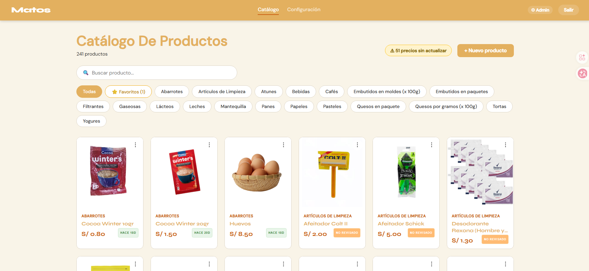
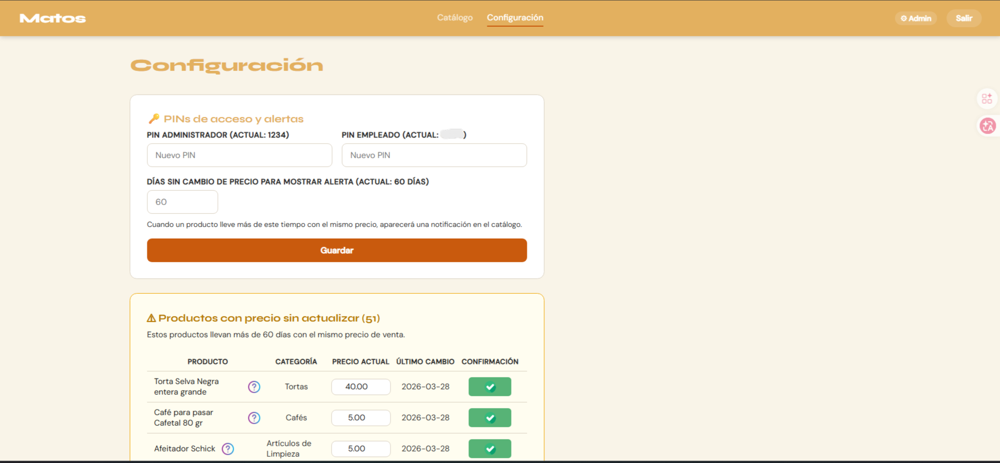
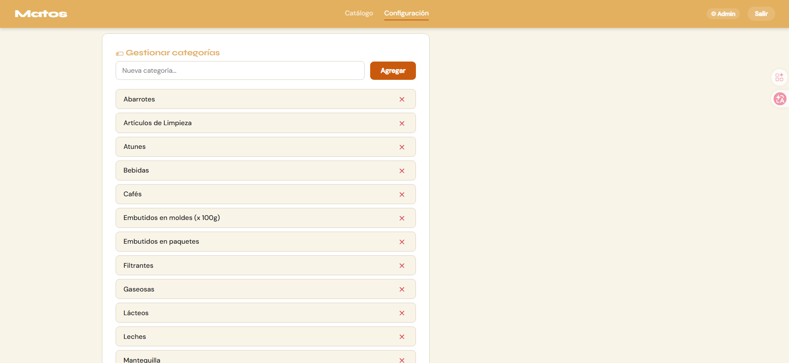
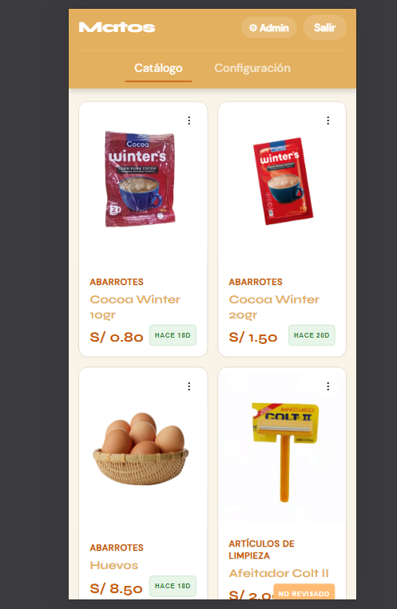

# 🥐 MiPos Cloud

**Cloud-based point-of-sale (POS) system for product and pricing management**, built for a bussines bakery and used as the empirical foundation for the university research project **TIBA 2026** (UTP).

---

## 📋 Table of Contents

- [About the project](#-about-the-project)
- [Features](#-features)
- [Tech stack](#-tech-stack)
- [Architecture](#-architecture)
- [Screenshots](#-screenshots)
- [From desktop to the cloud: MiPos' evolution](#-from-desktop-to-the-cloud-mipos-evolution)
- [Research context](#-research-context)
- [Roadmap](#-roadmap)
- [Author](#-author)

---

## 🧾 About the project

**MiPos Cloud** is a web-based point-of-sale application designed for small businesses that need to manage their product catalog, pricing, and access control from any device, without depending on a single local machine.

The system was born out of a real-world problem: a family bakery that needed to update prices and catalog data from multiple points (production, checkout, administration) in a synchronized and reliable way.

## ✨ Features

- 🛍️ **Product catalog** with image upload, cropping, and automatic background removal before publishing.
- ☁️ **Cloudinary-based image storage**, with signed uploads sent directly from the frontend.
- 🔄 **Near real-time sync** across devices via a lightweight polling endpoint (`/cambios`), designed to work within the constraints of a free-tier hosting plan.
- 🏷️ **Category filtering** and price-change alerts.
- 🗄️ **Managed PostgreSQL database** via Supabase, with per-request fresh connections to avoid idle-connection issues.

## 🛠️ Tech Stack

| Layer | Technology |
|---|---|
| Backend | Flask (Python) |
| Database | Supabase (PostgreSQL) |
| Images | Cloudinary (signed upload + processing) |
| Hosting | Render |
| WSGI server | Gunicorn + `eventlet` worker |
| Frontend | HTML, CSS, JavaScript (Cropper.js for image editing) |
| Sync | HTTP polling (replacing Socket.IO) |

## 🏗️ Architecture

One of the biggest technical challenges was designing an architecture that ran reliably within the constraints of free-tier hosting:

- Render's free tier doesn't reliably support persistent **WebSocket connections**, so Socket.IO was replaced with a lightweight polling endpoint (`/cambios`) that periodically checks for recent changes.
- To avoid conflicts between the `eventlet` worker and image uploads, Cloudinary uploads happen **directly from the frontend** via signed requests, bypassing the backend entirely.
- The deployment uses `gunicorn --worker-class eventlet -w 1 wsgi:app` to handle concurrency efficiently with a single worker.

## 🖼️ Screenshots

<!-- Replace these with your actual screenshots. Save them in an /assets folder in your repo. -->

| Product Catalog | Admin Panel |
|---|---|
|  |  |

| Image Editor | Mobile View |
|---|---|
|  |  |

## 🔁 From Desktop to the Cloud: MiPos' Evolution

MiPos didn't start as a cloud application: it began as a **local desktop app** (Flask + SQLite) running on a Windows 8.1 machine, with PIN-based access tiers, an image-cropping product catalog, and batch-script installers.

Migrating that system to a multi-user cloud architecture meant solving real infrastructure problems:

- Replacing a local database with a managed one (Supabase) without breaking catalog consistency.
- Adapting real-time sync to run within the limits of free-tier hosting.
- Redesigning the image pipeline so uploads wouldn't block the server.

That evolution — from a local system to a cloud solution in production — is also the starting point of my university research project.

## 🎓 Research Context

MiPos Cloud serves as the empirical case study for the **TIBA 2026** research project, developed at Universidad Tecnológica del Perú (Systems and Computer Engineering), with quantitative measurement instruments, observation sheets, and a perception survey applied over a 14-week data collection plan.

## 🗺️ Roadmap

- [ ] Yape/Plin sale notifications for checkout fraud prevention
- [ ] Sales reporting dashboard
- [ ] Offline mode with deferred sync

## 👤 Author

**Roosvelt** — Systems and Computer Engineering Student (UTP)

- GitHub: [RoosveltMM](https://github.com/RoosveltMM)
- LinkedIn: [Roosvelt Matos Morales](https://www.linkedin.com/in/roosveltmatos/)

---

⭐ If you find this project interesting, feel free to leave a star on the repository.
